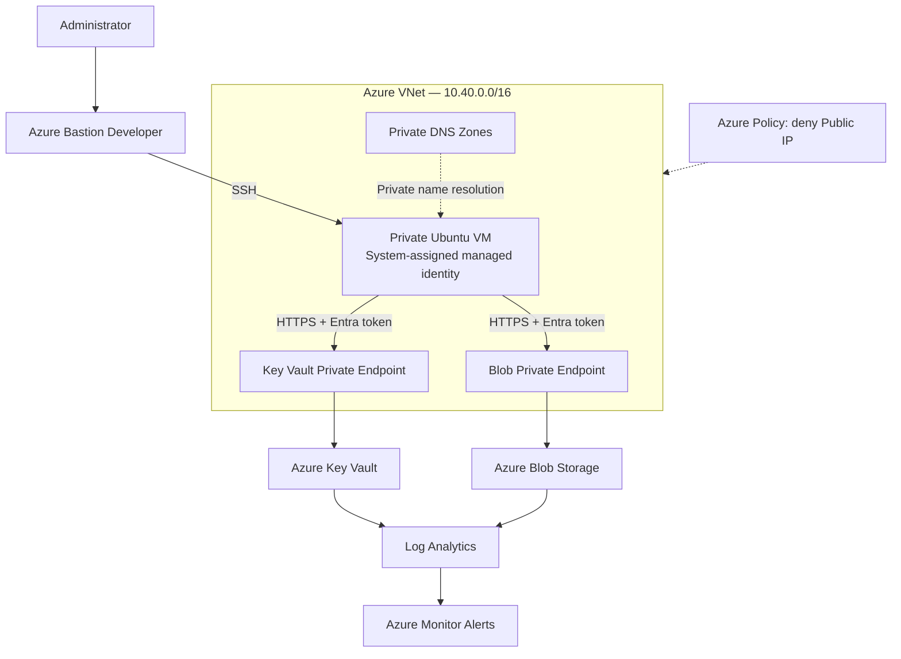

# Secure Azure Infrastructure

**Security by Design | Azure Infrastructure as Code | Identity, Network Isolation & Threat Detection**

A hands-on **Azure Cloud Security engineering project** deploying a private Linux workload and validating layered security controls using **Bicep**, **Azure PowerShell**, **Microsoft Entra managed identity**, **Private Link**, **Azure RBAC**, **Azure Policy**, and **Azure Monitor**.

> **What makes this project different:** Security controls are not only configured; selected controls are validated with **successful requests, denied operations, DNS evidence, policy enforcement, and triggered monitoring alerts**. This is a lab and portfolio project, not a production security certification.

## Highlights — verified in the lab

| Security objective | Implementation | Observed evidence |
| --- | --- | --- |
| Reduce VM exposure | Ubuntu VM with a private IP; Bastion Developer for SSH | [Private VM session](docs/screenshots/03-bastion-ssh.png) |
| Private access to PaaS | Private Endpoints and linked Private DNS Zones for Key Vault / Blob Storage | [DNS resolves to `10.40.2.30` / `10.40.2.20`](docs/screenshots/05-private-dns-resolution.png) |
| Eliminate application credentials | System-assigned managed identity with Azure RBAC | [Managed identity](docs/screenshots/02-vm-managed-identity.png) · [Role assignments](docs/screenshots/06-rbac-assignments.png) |
| Enforce least-privilege behavior | `Key Vault Secrets User`: read allowed, secret update denied | [HTTP 403 — `ForbiddenByRbac`](docs/screenshots/07-keyvault-security-test%282%29.png) |
| Restrict unwanted deployments | Resource-group-scoped Azure Policy denying Public IP resources | [Deployment blocked — `RequestDisallowedByPolicy`](docs/screenshots/09-policy-deny-public-ip.png) |
| Detect suspicious activity | Audit ingestion to Log Analytics and Azure Monitor alert rules | [Key Vault audit records](docs/screenshots/11-monitoring-logs.png.png) · [Key Vault alert](docs/screenshots/07-keyvault-security-test%281%29.png) |

**Additional validation:** An authenticated Blob Storage read returned **HTTP 200**; a separate unauthenticated request was rejected with `AuthorizationFailure`. That rejection demonstrates an authorization failure, **not independently a network firewall denial**. See [security validation](docs/security-validation.md).

## Architecture at a glance



**Network:** VM `10.40.1.4` · Blob Private Endpoint `10.40.2.20` · Key Vault Private Endpoint `10.40.2.30`. Diagram is conceptual; see the [full architecture and trust boundaries](docs/architecture.md).

## Technology stack

**Infrastructure:** Azure Bicep, Azure Resource Manager, Azure PowerShell  
**Networking:** Azure Virtual Network, NSG, Private Endpoints, Private DNS Zones, Azure Bastion Developer  
**Identity & access:** Microsoft Entra ID, system-assigned managed identity, Azure RBAC  
**Data services:** Azure Key Vault (Standard), Azure Blob Storage  
**Governance & detection:** Azure Policy, Azure Monitor, Log Analytics, KQL, email notifications

## Repository layout

```text
secure-azure-infrastructure/
├── README.md
├── .gitignore
├── infra/
│   ├── README.md
│   ├── main.bicep
│   └── modules/
│       ├── README.md
│       └── *.bicep
├── scripts/
│   ├── README.md
│   ├── deploy.ps1
│   └── cleanup.ps1
└── docs/
    ├── README.md
    ├── architecture.md
    ├── deployment.md
    ├── security-validation.md
    └── screenshots/
        ├── README.md
        └── *.png
```

The **PowerShell deployment entry point** calls the **root Bicep file** at `infra/main.bicep`; the root Bicep file orchestrates the modules. The scripts currently contain **local configuration placeholders** and must be reviewed before execution.

## Documentation

| Read this | For |
| --- | --- |
| [Architecture and security design](docs/architecture.md) | Network boundaries, private access, workload identity, RBAC and monitoring |
| [Security validation](docs/security-validation.md) | Test scenarios, expected/observed results, limitations and screenshots |
| [Deployment and cleanup](docs/deployment.md) | Prerequisites, paths, script configuration, safe execution and teardown |
| [Bicep infrastructure](infra/README.md) | Module responsibilities and how `main.bicep` is deployed |
| [PowerShell scripts](scripts/README.md) | What each script does, required edits and operational cautions |
| [Evidence index](docs/screenshots/README.md) | Original screenshot filenames and the claims each supports |

## Deployment — quick orientation

1. Clone the repository and inspect the Bicep parameters and PowerShell scripts.
2. Choose an Azure subscription with the necessary permissions, regional availability and quota.
3. Configure the resource-group name, location, unique Key Vault/Storage names, SSH key location and Bicep path in [`scripts/deploy.ps1`](scripts/deploy.ps1).
4. Sign in to the **correct subscription** and review the proposed resources and costs.
5. Run the deployment **only after resolving the placeholders and confirming parameter compatibility**.
6. Perform the validation scenarios and review [`scripts/cleanup.ps1`](scripts/cleanup.ps1) before removing resources.

**Start with the [complete deployment guide](docs/deployment.md), not the quick orientation above.** The checked-in scripts are not plug-and-play until customized.

## What was demonstrated — and what was not

- **Demonstrated:** Private DNS resolution; approved Private Endpoint connections; managed identity and role assignments; authorized Key Vault/Blob reads; RBAC denial for Key Vault write; denied Public IP deployment; observed audit events and alert notifications.
- **Important scope nuance:** `Storage Blob Data Reader` was observed at **Storage Account scope**, not container scope; a narrower assignment is a possible hardening step.
- **Not established by screenshots alone:** Complete absence of public connectivity, full production readiness, comprehensive incident response, or a formal penetration test.
- **Reproducibility caveat:** The provided PowerShell scripts retain example values and require adjustment. Actual Bicep module names and parameter definitions should be verified against the checked-in source.

## Next iterations

- Narrow Storage RBAC scope to the Blob container where appropriate.
- Add automated Bicep validation, deployment safety checks, and CI/CD without long-lived deployment secrets.
- Expand alert testing with reproducible KQL and recorded alert configuration.
- Add negative network-path tests to distinguish firewall blocking from authentication failures.
- Refine cleanup to avoid touching shared resource groups or unexpectedly purging Key Vaults.

## References

- [Bicep modules — Microsoft Learn](https://learn.microsoft.com/en-us/azure/azure-resource-manager/bicep/modules)
- [Deploy Azure resources with PowerShell — Microsoft Learn](https://learn.microsoft.com/en-us/azure/azure-resource-manager/templates/deploy-powershell)
- [Azure Private Endpoint — Microsoft Learn](https://learn.microsoft.com/en-us/azure/private-link/private-endpoint-overview)
- [Azure Private Endpoint DNS — Microsoft Learn](https://learn.microsoft.com/en-us/azure/private-link/private-endpoint-dns)
- [Azure RBAC assignments with Bicep — Microsoft Learn](https://learn.microsoft.com/en-us/azure/azure-resource-manager/bicep/scenarios-rbac)
- [Azure Policy — Microsoft Learn](https://learn.microsoft.com/en-us/azure/governance/policy/overview)
