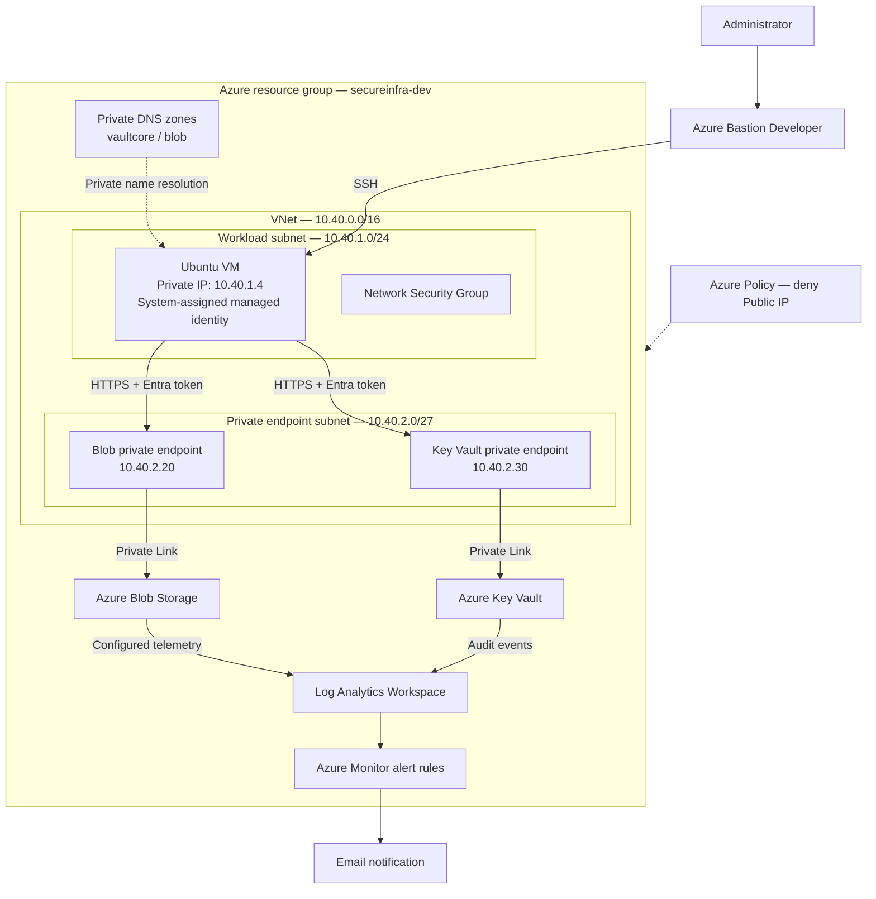

# Architecture — Secure Azure Infrastructure

> **Project type:** Hands-on Azure Cloud Security lab  
> **Deployment model:** Modular Azure Bicep templates  
> **Focus:** Private connectivity, workload identity, least-privilege access, governance, and detection

## 1. Architectural goal

This project demonstrates how to deploy an Azure workload with a reduced public attack surface and layered security controls. A private Ubuntu VM accesses Azure Key Vault and Azure Blob Storage using **private connectivity** and a **system-assigned managed identity**, without storing application credentials on the VM.

The environment also includes Azure Policy to restrict selected resource deployments and Azure Monitor / Log Analytics to collect security-relevant events and trigger alerts.

**Scope:** This is a reproducible learning and validation environment, not a claim of production certification or complete Zero Trust implementation.

## 2. Architecture diagram

*Conceptual diagram: control-plane management, Azure DNS resolution internals, and role-assignment dependencies are simplified.*

## 3. Network architecture

| Component | Configuration | Security purpose |
| --- | --- | --- |
| Virtual network | `10.40.0.0/16` | Isolates the lab's private network space |
| Workload subnet | `10.40.1.0/24` | Hosts the Ubuntu VM |
| VM network interface | `10.40.1.4` | Private workload connectivity; no VM public IP |
| Private endpoint subnet | `10.40.2.0/27` | Hosts the service private endpoints |
| Blob private endpoint | `10.40.2.20` | Private connectivity to Blob Storage |
| Key Vault private endpoint | `10.40.2.30` | Private connectivity to Key Vault |
| Network Security Group | Attached to the workload network configuration | Restricts traffic according to defined rules |
| Bastion Developer | Browser-based SSH access | VM administration without assigning a public IP to the VM |

### Private DNS resolution

Private DNS zones are associated with the virtual network so that applications continue to use normal Azure service hostnames while resolving to private endpoint IP addresses.

| Service FQDN | Private DNS zone | Observed private IP |
| --- | --- | --- |
| `<storage-account>.blob.core.windows.net` | `privatelink.blob.core.windows.net` | `10.40.2.20` |
| `<key-vault>.vault.azure.net` | `privatelink.vaultcore.azure.net` | `10.40.2.30` |

The VM's `nslookup` results validated both DNS resolution paths. **DNS resolution does not grant access:** authentication, Azure RBAC, and service network configuration remain independent controls.

## 4. Identity and authorization

The VM uses a **system-assigned managed identity** to request Microsoft Entra access tokens for the appropriate service audience. No long-lived application credential needs to be embedded in the workload for these calls.

| Principal | Azure RBAC role | Assignment scope | Intended access |
| --- | --- | --- | --- |
| VM managed identity | `Key Vault Secrets User` | Key Vault | Read secret values without permission to set secrets |
| VM managed identity | `Storage Blob Data Reader` | **Storage account** | Read Blob data without write permissions |

> **Least-privilege note:** The Storage role was observed at *storage-account scope*, not container scope. A narrower container-level scope is a possible future hardening improvement.

### Trust boundaries

1. **Administration:** Azure Bastion Developer enables SSH access to the VM without exposing a VM public IP.
2. **Network:** Private endpoints provide private IP paths to the two PaaS services.
3. **Identity:** The managed identity obtains service-specific access tokens.
4. **Authorization:** Data-plane access is evaluated against Azure RBAC permissions.
5. **Governance:** Azure Policy can deny deployments even when the caller possesses Azure RBAC permissions to create a resource.

## 5. Governance and monitoring

### Governance

An Azure Policy assignment at the resource-group scope denies deployment of Public IP address resources. A `New-AzPublicIpAddress` attempt returned `RequestDisallowedByPolicy` with HTTP `403`, validating the configured denial.

### Monitoring

Key Vault audit events were observed in the Log Analytics `AZKVAuditLogs` table. Azure Monitor notifications were received for the configured unauthorized Key Vault and Blob Storage access alerts.

The screenshots demonstrate **log ingestion** and **alert firing**. The exact alert query logic, evaluation frequency, and notification routing should be documented separately in the monitoring module and security validation notes.

## 6. Security validation evidence

| Validation | Observed result | Evidence |
| --- | --- | --- |
| Private endpoints | Storage and Key Vault connections approved | [Storage](screenshots/04-private-endpoints%281%29.png) · [Key Vault](screenshots/04-private-endpoints.png) |
| Private DNS | Service hostnames resolve to `10.40.2.20` / `10.40.2.30` | [DNS output](screenshots/05-private-dns-resolution.png) |
| Managed identity | System-assigned identity enabled | [Identity output](screenshots/02-vm-managed-identity.png) |
| Azure RBAC | Key Vault Secrets User and Storage Blob Data Reader roles visible | [RBAC output](screenshots/06-rbac-assignments.png) |
| Key Vault read | Secret retrieval succeeded from the VM | [Authorized read](screenshots/07-keyvault-security-test.png) |
| Key Vault write denial | Secret modification returned `403 ForbiddenByRbac` | [Denied write](screenshots/07-keyvault-security-test%282%29.png) |
| Blob container listing | Authenticated Blob container list request returned `200 OK` and an empty listing | [HTTP 200 result](screenshots/08-storage-private-access%281%29.png) |
| Policy denial | Public IP deployment rejected by Azure Policy | [Policy rejection](screenshots/09-policy-deny-public-ip.png) |
| Key Vault audit logs | Audit events visible through KQL | [Audit events](screenshots/11-monitoring-logs.png.png) |
| Alert notifications | Unauthorized Key Vault and Blob alert notifications fired | [Key Vault alert](screenshots/07-keyvault-security-test%281%29.png) · [Blob alert](screenshots/08-storage-private-access%282%29.png) |

See [`security-validation.md`](./security-validation.md) for the commands, preconditions, expected outcomes and detailed evidence. The screenshots demonstrate authenticated **container listing**, not retrieval of an existing blob's contents.

## 7. Scope, limitations, and next improvements

- **Security claims must match evidence.** An unauthenticated external Blob request returning `AuthorizationFailure` does **not**, by itself, prove that the network firewall rejected it. Public-network restrictions should be demonstrated from the effective resource configuration and/or a network-specific denial test.
- The private DNS and RBAC tests were executed in the lab environment and do not establish a formal penetration test or a production security review.
- The project uses Key Vault **Standard**; it does not claim to use customer-managed HSM-backed keys.
- A container-scoped Blob Data Reader assignment could further reduce the scope of the VM's data permissions.
- Possible future work: automated deployment validation in CI, policy compliance reporting, improved monitoring dashboards, and a documented identity/secret lifecycle.

## 8. References

- [Azure Private Endpoint overview — Microsoft Learn](https://learn.microsoft.com/en-us/azure/private-link/private-endpoint-overview)
- [Private Endpoint DNS configuration — Microsoft Learn](https://learn.microsoft.com/en-us/azure/private-link/private-endpoint-dns)
- [Bicep modules — Microsoft Learn](https://learn.microsoft.com/en-us/azure/azure-resource-manager/bicep/modules)
- [Azure RBAC role assignments with Bicep — Microsoft Learn](https://learn.microsoft.com/en-us/azure/azure-resource-manager/bicep/scenarios-rbac)
- [Azure Policy overview — Microsoft Learn](https://learn.microsoft.com/en-us/azure/governance/policy/overview)
